# Praktikum 10: UV-Mapped PBR Asset — Blender Materials, UV & Texturing

**Mata Kuliah:** EF234504 — Grafika Komputer  
**Departemen:** Teknik Informatika, FTEIC, Institut Teknologi Sepuluh Nopember (ITS)  
**Dosen Pengampu:** Dr. Darlis Herumurti  

---

## Informasi Kelompok

* **Nama Kelompok:** Kelompok YOLO
* **Anggota Kelompok:**
  1. **Jalu Cahyo Senodiputro** (NRP: `5025241155`)
  2. **Erlangga Rizqi Dwi Raswanto** (NRP: `5025241179`)
* **Repositori:** [https://github.com/erlanggardr/praktikum-grafkom](https://github.com/erlanggardr/praktikum-grafkom)
* **Video Demo:** `TODO — isi link video sebelum pengumpulan`

---

## 1. Asset & Hasil Akhir

* **Nama Asset:** `SciFi_Crate` — peti hard-surface industrial hasil **Praktikum 9** (model yang sama, geometri tidak diubah).
* **Berkas utama:** [`P10_YOLO_SciFiCrate.blend`](./P10_YOLO_SciFiCrate.blend) · tekstur di [`textures/`](./textures) · bukti di [`screenshots/`](./screenshots).
* **Model eksternal (tugas tambahan & demo scene):** *Damaged Helmet* (PBR lengkap).

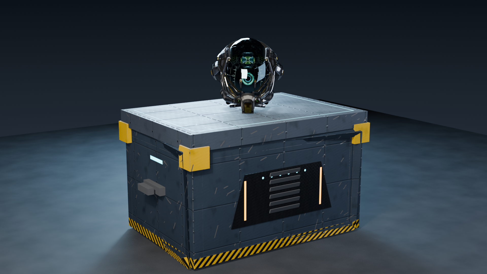

Asset P9 terdiri dari 6 objek (`Crate_Body`, `Crate_Lid`, `Corner_Reinforcements`, `Front_Armor_Plate`, `Modular_Handles`, `Vent_Grille_Array`). Jumlah vertex/face tiap objek identik dengan [`praktikum-9/P09_YOLO_SciFiCrate.blend`](../praktikum-9/P09_YOLO_SciFiCrate.blend) (mis. body 200 vert / 278 face).

---

## 2. Persiapan Geometry (sebelum UV)

| Pemeriksaan | Temuan | Tindakan |
|---|---|---|
| Apply Scale / Rotation | Semua objek sudah scale `1.0`, rotation `0` | Tidak perlu apply ulang; dikonfirmasi lewat skrip |
| Normal | Arah normal tidak konsisten di beberapa bagian | `Recalculate Outside` (bmesh) per bagian |
| Modifier | `Mirror`, `Array`, `Solidify` | Di-apply supaya UV mencakup seluruh geometri |
| Bevel | Lebar bevel berbeda per bagian (0,008–0,025) | **Tidak di-bake.** Disimpan sebagai *bevel weight* per edge + satu modifier `Bevel` non-destruktif, sehingga bentuk visual sama dengan P9 |
| Penggabungan | 6 objek dengan UV sendiri-sendiri akan saling menimpa pada satu texture | Digabung menjadi 1 objek `SciFi_Crate` (390 face, 2 material slot) dengan **satu** layout UV |
| Non-manifold | `Crate_Body` P9 adalah kitbash kotak yang saling menembus: **120 edge dipakai > 2 face** (face internal tersembunyi) | Geometri P9 **sengaja tidak diubah**. Face internal diberi island sendiri dan diperkecil (lihat §4) |

---

## 3. Strategi Seam & UV Island

Seam dibuat dengan aturan yang bisa direproduksi (`scripts/uv_pipeline.py`), bukan klik acak:

1. **Seam di setiap batas arah normal dominan** (±X, ±Y, ±Z). Hasilnya island berbentuk "sisi kotak" yang hampir datar, sehingga unwrap tidak memerlukan distorsi.
2. **Edge non-manifold / boundary selalu di-seam** supaya face internal tidak menempel ke permukaan terlihat.
3. **Island sangat kecil** (< 0,004 m², umumnya strip bevel) **digabung** ke tetangga dengan batas bersama terpanjang. Island turun dari 228 → 214 sebelum checker loop.
4. **Checker loop** (§5) menambah seam hanya pada face yang bermasalah.

Hasil akhir: **571 seam edge**, **254 island**.

| Foto | Keterangan |
|---|---|
| 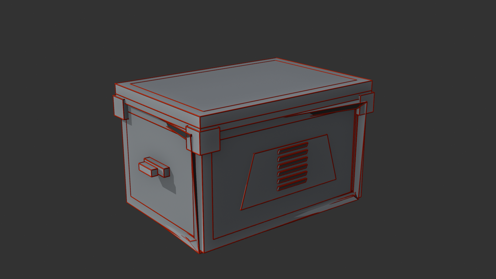 | Seam (merah) di semua tepi keras |
| 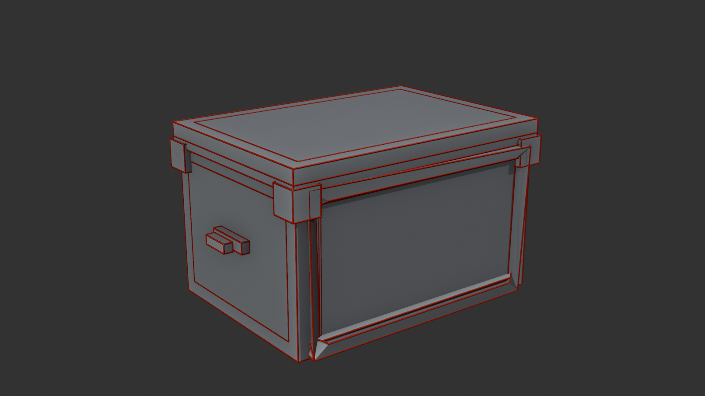 | Sisi belakang |

### Fungsi UV Island utama

| Island | Fungsi |
|---|---|
| **Body panels** (persegi besar, biru) | Sisi depan/belakang/kiri/kanan/atas/bawah badan peti. Area terluas, memuat panel, groove, rivet, dan hazard stripe skirt |
| **Lid** (cyan) | Tutup peti + plat atas; memuat cincin LED cyan |
| **Corner Reinforcements** (kuning, deretan persegi kecil di atas) | Bracket sudut dan latch; cat kuning dengan *edge wear* |
| **Front Armor Plate** (abu-abu trapesium) | Plat armor logam telanjang + diamond tread + LED oranye/cyan |
| **Handles / Vent slats** (merah/ungu, strip di kanan) | Karet; memakai material terpisah (multi-material) |
| **Hidden internal faces** (abu-abu) | Tidak terlihat; sengaja diperkecil agar tidak memboroskan ruang texture |

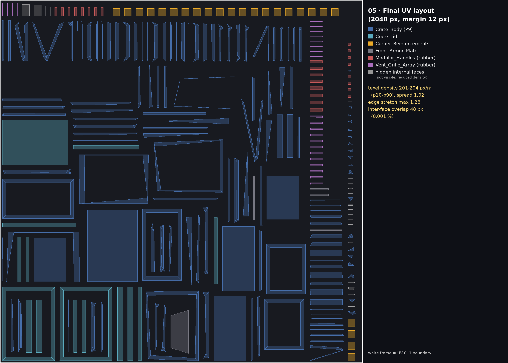

---

## 4. Texel Density & Packing

* **Strategi:** setiap island diskalakan sehingga rasio luas UV : luas 3D sama (target = rata-rata berbobot luas). Face tersembunyi diberi skala 0,15×. Semua island kemudian di-pack dengan **skala seragam** (menjaga rasio relatif).
* **Margin:** `0,006` ruang UV = **12,3 px @2K** (≈ 24,6 px @4K) — di atas batas 4 px yang diminta.

Diukur dengan `scripts/uv_metrics.py` (face terlihat, referensi 2048 px):

| Metrik | Hasil |
|---|---|
| Face terlihat / tersembunyi | 364 / 26 |
| Texel density p10 – median – p90 | **201 – 202 – 204 px/m** (spread p90/p10 = **1,02**) |
| Texel density @4096 (tekstur final) | ≈ 404 px/m (≈ 2,5 mm/px) |
| Stretch per face (rasio edge maks/min) | median 1,00 · p95 1,02 · **maks 1,28** · face > 1,5: **0** |
| Face di luar 0–1 | **0** |
| Overlap antar-face | **48 px dari 4,19 juta (0,001 %)** — sentuhan sub-piksel pada face sliver tipis, bukan overlap area |
| Coverage UV | 28,5 % (island tipis memang tidak bisa dipack rapat) |

---

## 5. Checker Test, Distorsi & Perbaikan

Tekstur checker 32×32 berwarna (`textures/crate_checker_test.png`) dipasang pada seluruh crate.

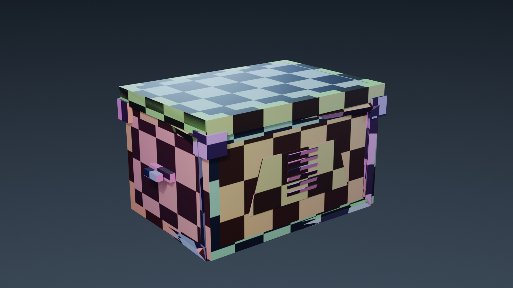

| Tahap | Masalah | Perbaikan |
|---|---|---|
| Unwrap awal ([`03_initial_unwrap.png`](./screenshots/03_initial_unwrap.png)) | Skala island tidak seragam; **22 face stretch > 1,30**; **24 pasang face terlipat/overlap** | Skrip checker loop: face yang stretch diberi seam di sekelilingnya (island sendiri), pasangan terlipat dipotong di edge bersamanya, lalu unwrap ulang. Round 0: 22 → round 1: **0** face stretch |
| Skala | Island besar dan kecil punya density berbeda | Normalisasi density per island (§4) |
| Overlap | Sisa lipatan pada face sliver | Margin dinaikkan 8 → 12 px; sisa overlap 48 px (sub-piksel) |
| Face tersembunyi | Awalnya klasifikasi "tersembunyi" terlalu agresif (toleransi 2 mm): chamfer skirt yang terlihat ikut diperkecil sehingga hazard stripe **buram** | Toleransi dilonggarkan ke 3,5 cm (≈ lebar bevel). Face tersembunyi turun 171 → 26 |

Sisa distorsi kecil terlihat di chamfer bawah (trapesium tipis) — itu bentuk geometri P9 itu sendiri, bukan kesalahan unwrap.

---

## 6. Material PBR (Principled BSDF)

Tekstur crate dibuat sendiri (prosedural, `scripts/make_textures.py`) dengan teknik *position bake*: tiap texel UV dipetakan kembali ke posisi/normal 3D, lalu pola dihitung dari posisi 3D. Pola karenanya selalu benar untuk layout UV apa pun. Ukuran **4096 × 4096**.

| Map | File | Color Space | Input Principled BSDF |
|---|---|---|---|
| Base Color | `crate_base_color.png` | **sRGB** | Base Color |
| Roughness | `crate_roughness.png` | **Non-Color** | Roughness |
| Metallic | `crate_metallic.png` | **Non-Color** | Metallic |
| Normal (tangent, OpenGL) | `crate_normal.png` | **Non-Color** | Normal Map node → Normal |
| Emission Color | `crate_emission.png` | **sRGB** | Emission Color |
| Emission Mask | `crate_emission_mask.png` | **Non-Color** | Math (× 4,0) → Emission Strength |

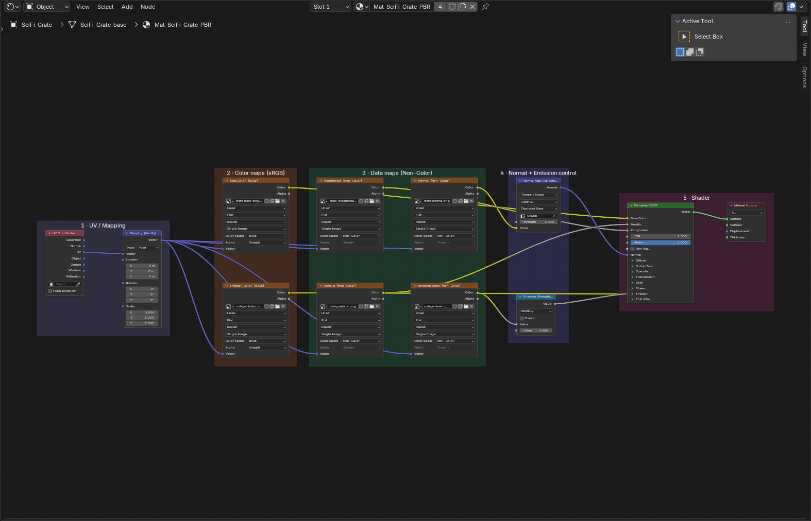

Node graph disusun dalam 5 frame berlabel: *UV/Mapping* · *Color maps (sRGB)* · *Data maps (Non-Color)* · *Normal + Emission control* · *Shader*. Normal dihubungkan **melalui Normal Map node** (Tangent Space, UV Map `UVMap`).

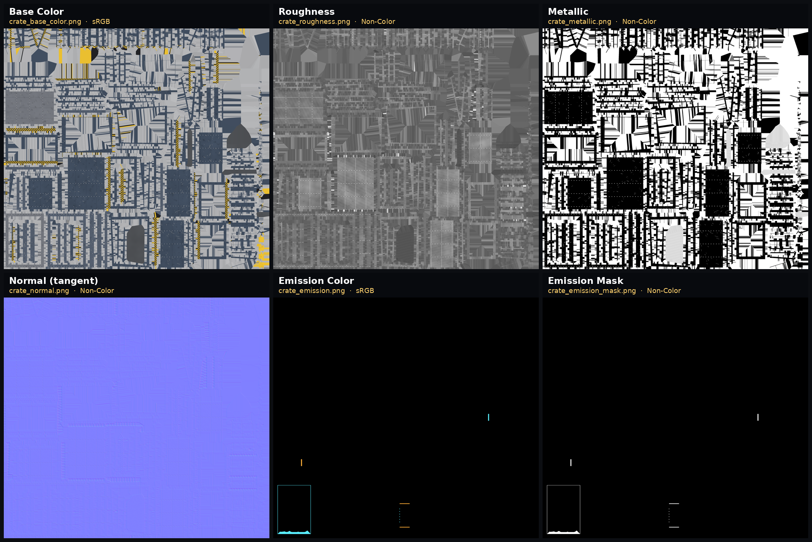

### Metal, non-metal, emission, normal detail

* **Non-metal (cat):** body, lid, bracket kuning → `metallic = 0`, roughness 0,4–0,7 yang bervariasi.
* **Metal:** plat armor = logam gunmetal telanjang (`metallic ≈ 0,92`, roughness brushed); cat terkelupas di tepi dan goresan → baja (`metallic` 1,0 / 0,45); kepala rivet = baja.
* **Karet:** handle dan vent slat memakai material terpisah `Mat_Handle_Rubber` (non-metal, kasar).
* **Emission (aksen):** dua bar LED oranye + deret titik cyan di plat armor, cincin cyan di plat lid, bar status cyan/oranye di sisi ±X. Emission **dikendalikan mask terpisah** (Non-Color), bukan dari warna.
* **Normal detail:** groove panel (−2,8 mm), kepala rivet (+3 mm), diamond tread plat armor (0,9 mm), strip hazard timbul, langkah cat terkelupas, butiran halus.

| Emission | Normal Map ON/OFF |
|---|---|
| 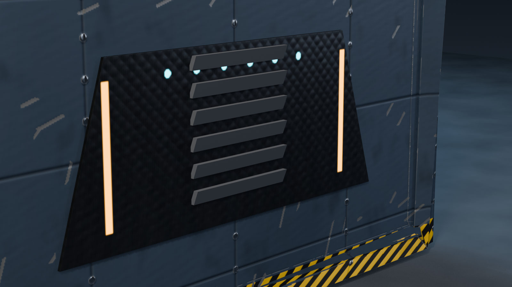 | 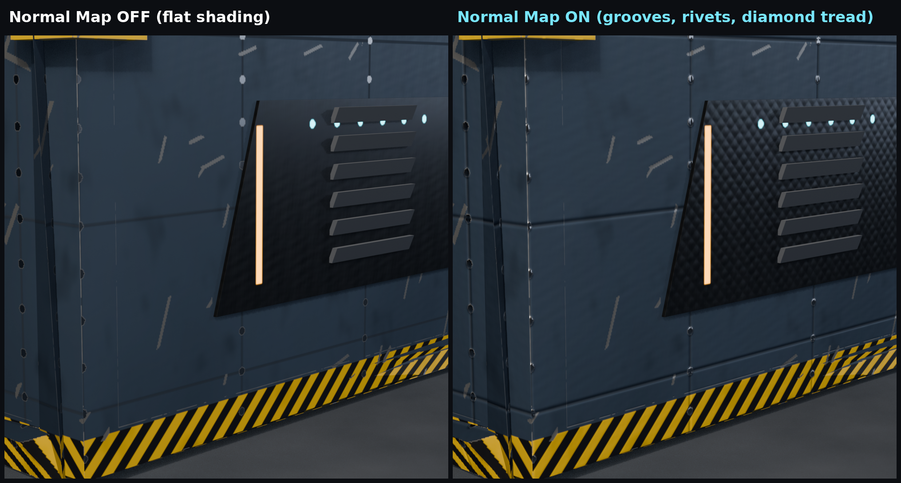 |

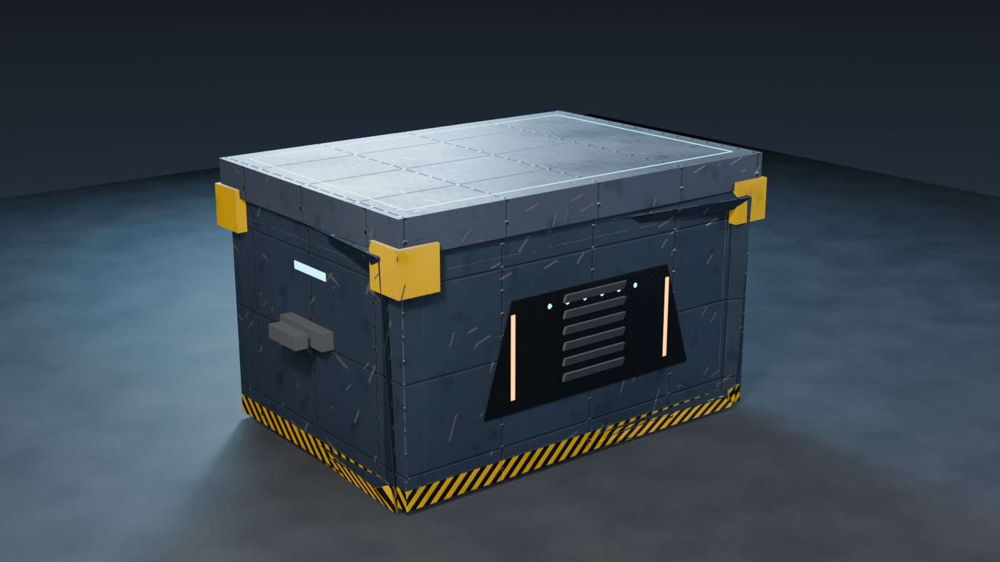

---

## 7. Challenge yang Dikerjakan

| # | Challenge | Bukti |
|---|---|---|
| 1 | **Multi-material surface** — 2 material slot: atlas PBR (peti) dan karet (handle/vent) | §6, `10_final_pbr_crate.png` |
| 2 | **Metal + painted surface** — cat non-metal, plat armor logam, edge wear yang membuka baja | `crate_metallic.png`, `09_emission_accent.png` |
| 3 | **Custom emission mask** — mask Non-Color terpisah × strength, warna per LED dari map sRGB | `crate_emission_mask.png`, `09_emission_accent.png` |
| 4 | **Custom roughness variation** — roughness berbintik (noise 3D), groove kasar, goresan licin, brushed pada logam | `crate_roughness.png` |
| 5 | **Normal detail** — groove, rivet, diamond tread, grain | `08_normal_map_detail.png` |

---

## 8. Tugas Tambahan — Eksplorasi PBR Material (Damaged Helmet)

* **Model:** *Damaged Helmet* (helm sci-fi bergaya pertempuran).
* **Sumber:** [KhronosGroup/glTF-Sample-Assets — DamagedHelmet](https://github.com/KhronosGroup/glTF-Sample-Assets/blob/main/Models/DamagedHelmet/README.md). Berkas asal: `assets/models/DamagedHelmet.glb`.
* **Kredit & lisensi** (sesuai README Khronos): model asli *Battle Damaged Sci-fi Helmet – PBR* oleh **theblueturtle_** (2016) berlisensi **CC BY-NC 4.0**; konversi/rebuild glTF oleh **ctxwing** (2018) berlisensi **CC BY 4.0**. Dipakai **non-komersial untuk pembelajaran**, dengan atribusi di atas.
* **Texture map yang tersedia (5):**

| Map | File | Color Space | Dihubungkan ke |
|---|---|---|---|
| Base Color | `helmet_base_color.png` | sRGB | Base Color |
| Metallic-Roughness (packed: G = roughness, B = metallic) | `helmet_roughness_metallic.png` | Non-Color | Separate Color → Roughness (G), Metallic (B) |
| Normal | `helmet_normal.png` | Non-Color | Normal Map node → Normal |
| Occlusion (R) | `helmet_occlusion.png` | Non-Color | glTF Material Output (Occlusion) |
| Emission | `helmet_emission.png` | sRGB | Emission Color |

`helmet_roughness.png` dan `helmet_metallic.png` adalah hasil ekstraksi kanal dari map packed (referensi saja, tidak terhubung ke node).

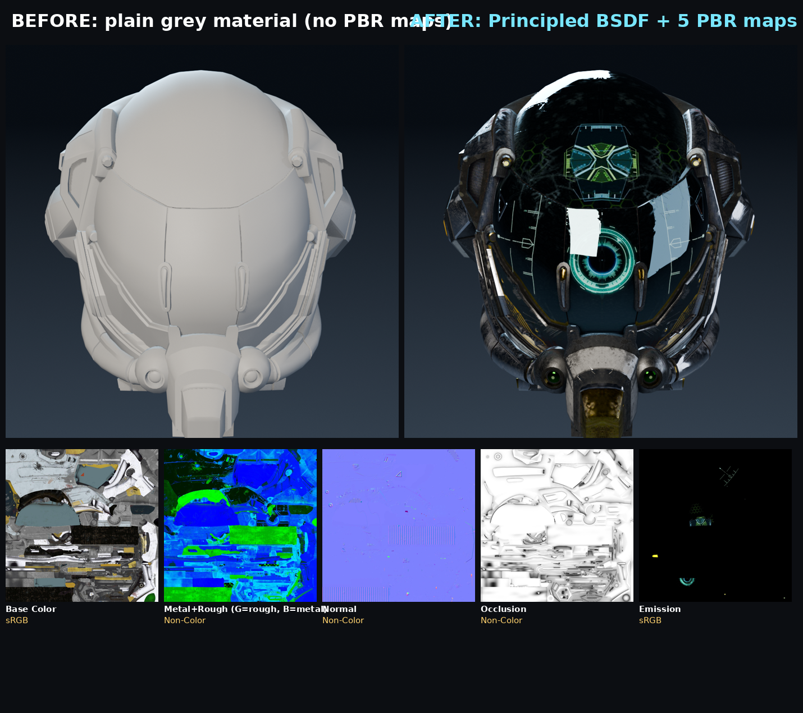

Perbandingan: kiri = material abu-abu polos tanpa map; kanan = Principled BSDF dengan kelima map.

---

## 9. Scene Demo (Modeling + Texturing + Lighting + Camera + Render)

| Elemen | Pengaturan |
|---|---|
| Model sendiri | `SciFi_Crate` (P9) + UV + material + tekstur buatan sendiri |
| Model eksternal | Damaged Helmet (PBR lengkap), skala 0,40, duduk tepat di atas lid (z = 0,70), visor menghadap kamera |
| Ground | Plane 12 × 12 m, material beton prosedural (noise + bump), tepat di bawah peti |
| Lighting | 3 area light: **Key** hangat (520 W), **Fill** biru lembut (110 W), **Rim** cyan dari belakang (380 W); World gradien dingin sebagai ambience/pantulan logam |
| Kamera | Lensa **52 mm**, sisi +Y (memperlihatkan plat armor + LED), DOF f/9 fokus ke peti |
| Render | **Eevee**, 96 sampel, 1920 × 1080, AgX |
| Fokus visual | Plat armor dengan LED sebagai titik fokus, helm sebagai aksen atas |

---

## 10. Kendala & Solusi

| Kendala | Solusi |
|---|---|
| Mesh body P9 berisi face internal → UV berserakan (218 seam, ratusan serpihan), texel density timpang ~39× | Seam berbasis arah normal dominan + gabung island kecil + normalisasi density + deteksi face tersembunyi |
| Bevel yang di-bake menghasilkan sliver (face ±1 mm²) → density ekstrem dan overlap | UV dibuat di mesh dasar (sebelum bevel); bevel dipertahankan sebagai modifier non-destruktif |
| Mencoba menghapus face internal membuat mesh bolong | Geometri P9 dipertahankan apa adanya; face internal ditangani di level UV |
| Hazard stripe buram pada chamfer skirt | Perbaikan toleransi klasifikasi face tersembunyi (§5) |
| 6 objek berbagi satu texture tapi UV masing-masing menimpa | Digabung jadi satu objek dengan satu layout |
| Helm: `rotation_euler` tidak berpengaruh | Helm hasil impor glTF memakai mode quaternion → rotasi diatur lewat quaternion |
| Texture helm masih ter-pack di dalam .blend | Diganti ke file eksternal relatif di `textures/` |
| Blender sempat crash di tengah pengerjaan | Skrip dipecah per tahap + checkpoint; seluruh proses bisa diulang lewat `scripts/` |

---

## 11. Struktur Repositori

```
praktikum-10/
├── P10_YOLO_SciFiCrate.blend      # file final
├── README.md  ·  DEMO_SCRIPT.md
├── textures/                      # semua tekstur (relatif, tidak ada yang missing)
├── screenshots/                   # bukti proses (01–12)
├── scripts/                       # build_material · uv_pipeline · uv_metrics · make_textures
├── assets/models/                 # DamagedHelmet.glb · P10_YOLO_Scene.glb (web viewer)
└── index.html · app.js · src/     # web viewer
```

Verifikasi: file `.blend` + `textures/` disalin ke folder lain lalu dibuka di Blender headless → **tidak ada texture missing**; semua 11 image berpath relatif; color space sesuai tabel.

---

## 12. Checklist Pengumpulan

- [x] UV layout rapi, tanpa face di luar 0–1, margin 12 px, overlap sub-piksel
- [x] Texel density seragam (spread 1,02) dan diperiksa
- [x] Node graph tersusun dalam frame berlabel
- [x] Color space setiap map tepat (sRGB: base color & emission; Non-Color: sisanya)
- [x] Texture tidak hilang (diuji pada salinan terpisah)
- [x] ≥ 2 challenge (dikerjakan 5)
- [x] Tugas tambahan PBR: sumber, lisensi, daftar map, perbandingan sebelum/sesudah
- [x] Final render Eevee
- [ ] `TODO` Link video demo (lihat [`DEMO_SCRIPT.md`](./DEMO_SCRIPT.md))
- [ ] `TODO` Link repository GitHub dikumpulkan di Classroom
